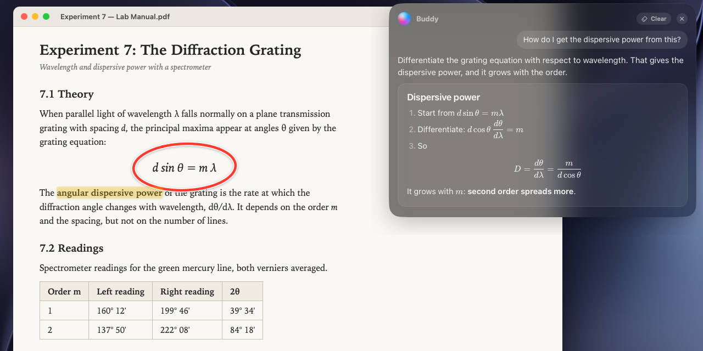
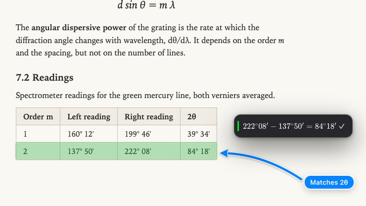
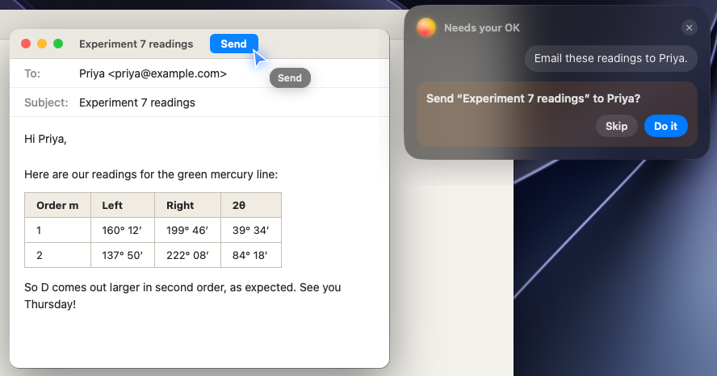
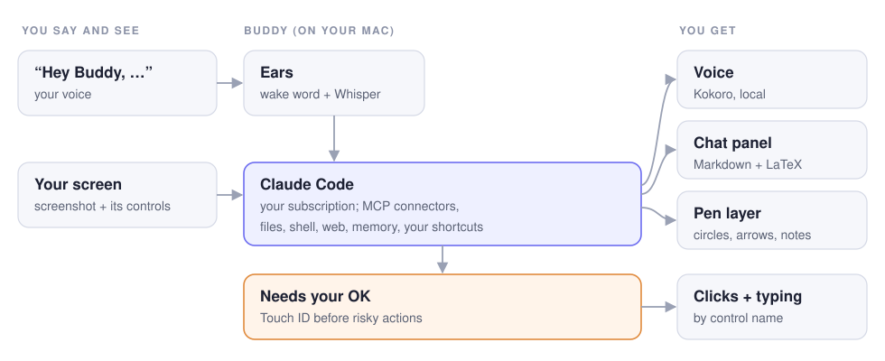

# Buddy

**A voice assistant for your Mac, powered by Claude Code.** Say “Hey Buddy”, ask a question out loud, and it looks at your screen, answers out loud, writes up the details (with math) in a little panel, draws on your screen like a teacher with a pen, and can click, type and use your connectors for you, asking for Touch ID before anything risky.

   



<table>
<tr>
<td width="50%"><br><sub><b>A pen on your screen.</b> “Can you check my second-order reading?”</sub></td>
<td width="50%"><br><sub><b>Needs your OK.</b> Sending, deleting or paying waits for Touch ID.</sub></td>
</tr>
</table>

It costs nothing beyond your existing Claude subscription:

| Part | What it uses | Cost |
|---|---|---|
| Brain | Claude through the `claude` CLI (Claude Code), signed in with your Pro/Max account | your subscription |
| Ears | Whisper small.en running locally (whisper.cpp), with Apple's recognizer for the live preview | free |
| Voice | Kokoro neural TTS running locally (Apple's voice as fallback) | free |
| Eyes | ScreenCaptureKit screenshot of the screen under your mouse | free |

## Requirements

- A Mac on macOS 14 (Sonoma) or later; Apple Silicon recommended for local Whisper and Kokoro.
- [Claude Code](https://claude.com/claude-code) (`claude` CLI) signed in with a Claude Pro or Max account.
- Xcode Command Line Tools (`xcode-select --install`) for `swiftc`.
- Optional: Homebrew (whisper.cpp) and Python 3.11 (Kokoro voice).

## Setup

1. Clone the repo:
   ```bash
   git clone https://github.com/yxshv/buddy.git && cd buddy
   ```

2. Make sure Claude Code is signed in with your subscription:
   ```bash
   claude
   ```
   then type `/login` and choose your Claude account (not an API key).
3. Install local Whisper (optional but recommended; without it Buddy uses Apple's recognizer):
   ```bash
   brew install whisper-cpp
   ```
   ```bash
   mkdir -p ~/Library/Application\ Support/Buddy/models && curl -L -o ~/Library/Application\ Support/Buddy/models/ggml-small.en-q5_1.bin https://huggingface.co/ggerganov/whisper.cpp/resolve/main/ggml-small.en-q5_1.bin
   ```
4. Install the Kokoro voice (optional; without it Buddy uses Apple's voice):
   ```bash
   K=~/Library/Application\ Support/Buddy/kokoro && mkdir -p "$K" && python3.11 -m venv "$K/venv" && "$K/venv/bin/pip" install kokoro-onnx soundfile && curl -L -o "$K/kokoro-v1.0.onnx" https://github.com/thewh1teagle/kokoro-onnx/releases/download/model-files-v1.0/kokoro-v1.0.onnx && curl -L -o "$K/voices-v1.0.bin" https://github.com/thewh1teagle/kokoro-onnx/releases/download/model-files-v1.0/voices-v1.0.bin
   ```
5. Build (and optionally install to /Applications):
   ```bash
   ./build.sh --install
   ```
6. Open Buddy. Its icon appears in the menu bar. Allow **Microphone**, **Speech Recognition** and **Screen Recording** when asked. macOS needs a relaunch after granting Screen Recording.

## Use

- Say **“Hey Buddy”**, then your question, in one go or with a pause, like Siri. Buddy notices when you stop talking. A Siri-style panel appears at the top right and turns into a chat: your questions as bubbles, Buddy's answers (with Markdown and LaTeX) underneath. It scrolls, and it stays put while you work in other apps until you press its ✕.
- After it answers, just keep talking: Buddy listens for about 6 seconds for a follow-up, no “Hey Buddy” needed, and adds it to the chat. After that, say “Hey Buddy” to ask more in the same chat. Once you close it, the next question starts a fresh one (everything is still in **Chats…**).
- Say “Hey Buddy” again while it's talking to interrupt it.
- Need time to think out loud? Press **⌃⌥L** (or **Listen Until Return** in the menu) and Buddy keeps listening through pauses until you press **Return** (or ⌃⌥L again); **Esc** cancels. Press it before you start, or in the middle of a sentence when Buddy is already listening. The panel shows **Return to send** while it's locked. Return and Esc only go to Buddy during that time, and a locked capture stops on its own after 3 minutes. Without the lock, Buddy now waits 1.5 seconds of quiet (was 1.2) before deciding you're done.
- When you're finished, just say so ("that's all", "thanks, bye", "I'll continue this later"): Buddy says goodbye and stops listening instead of waiting for another question.
- Wake-word listening runs entirely on your Mac (Apple's on-device recognizer; audio never leaves the Mac) and costs about 3% CPU. macOS shows the orange mic dot while it's on. Turn it off with **Listen for “Hey Buddy”** in the menu; **Ask Buddy** in the menu works either way.
- The blue cursor buddy stays hidden. It only pops out of your cursor to point at something or click it, then disappears.
- Pick a voice under **Voice** in the menu (Heart, Bella, Michael, Emma, George, or Apple's).
- To check the design without the mic or Claude: `open -n -a Buddy --args --demo` plays every panel state.
- Menu bar: switch model (Haiku for speed, Sonnet for balance, Opus for brains), mute speech, or start a new conversation.

### Drawing on your screen

Buddy can mark up your screen like a teacher with a pen: it circles things, boxes buttons, draws arrows, underlines and highlights text, and sticks small note cards next to things. Longer write-ups (explanations, proofs, derivations, worked steps) go into the chat panel itself, with proper math (LaTeX, rendered with KaTeX, bundled offline). Ask "what does this equation mean?" or "walk me through this derivation" and it says the gist out loud while the details appear in the panel.

- The drawings sit on a transparent layer: clicks go straight through to your apps, and Buddy never sees its own drawings in screenshots.
- Circles, arrows and notes go away when you say "Hey Buddy" again, when Buddy starts doing a task, or when you close the panel. While anything is drawn, a **Clear** button sits at the top right of the panel (or **Clear drawings** at the top right of the screen once the panel has gone), and the menu has **Clear drawings** too.

### The chat panel and your chats

- The panel shows Buddy's reply with Markdown and LaTeX. It grows with the answer, widens when there's a write-up with math, and scrolls once it reaches the bottom of the screen.
- Click the panel (or choose **Chats…** in the menu) to open a window with every conversation: search, switch between chats with ↑/↓, and copy text. Chats are saved in `~/Library/Application Support/Buddy/chats.json`; a new chat starts after 30 minutes of quiet or when you choose **New conversation**.
- To check the look without Claude: `open -n -a Buddy --args --canvas-test <folder>` draws a sample for 5 seconds and saves `canvas.png` into the folder, and `open -n -a Buddy --args --demo --snap <folder>` walks through the panel (with a write-up, a drawing and the chats window) and saves screenshots. To tweak the design in a browser, serve the `canvas` folder (`python3 -m http.server --directory canvas`) and open `preview.html`, `reply.html` or `chats.html`.

### Connectors and computer control

- Buddy is a full Claude Code underneath, working from your home folder: it can run commands, read and edit files, search the web, and use every MCP server the `claude` CLI has (Obsidian, Google Drive, Gmail, Calendar, Todoist, …). "Find my Astro site and publish this note" works.
  - Looking never asks: reading files and notes, searching, `ls`, `cat`, `git status` and the like, and connector lookups.
  - Anything that changes things (other commands, editing files, changing notes, sending, creating, deleting) shows the **Needs your OK** card with the exact command or file, and Buddy asks out loud. Approve with **Touch ID** (or your password when Touch ID isn't available); cancel the prompt or press Cancel on the card to decline. Your voice and keyboard can't approve anything, and saying "Hey Buddy" while a card is up declines it. After one yes, the rest of that request runs without asking again, except destructive ones (`rm`, `sudo`, force-push, `git reset --hard`, deleting, sending, paying), which ask every time.
  - Claude Code's own instructions, your `CLAUDE.md` and its memory are kept. Tell Buddy how you do something ("this is how I publish my Obsidian notes…") or to remember something, and it saves it to memory (`~/.claude/projects/-Users-<you>/memory/`) without asking, then uses it next time.
  - MCP servers come from the CLI's config (`claude mcp list`), not the Claude desktop app's; add new ones with `claude mcp add`.
- Ask it to **do** something ("open Wikipedia", "search for X", "delete this") and it works one step at a time, looking at the screen again after each step (up to 15 steps). It works quietly: no narration of each click, only a spoken question when it needs you and one short line when it's done. Everyday, undoable steps (opening, navigating, searching, ticking checkboxes, toggling, typing into fields) run straight away. Anything that deletes, sends, submits, posts, shares, buys, pays or changes settings shows an orange card first (buttons labelled Delete, Send, Pay, Share and the like always do, even if Claude forgets to mark them): approve it with Touch ID, or cancel. Keys like ⌘Delete, ⌘S, ⌘W and ⌘Q always ask, even if Claude thinks they're safe. Once you've said yes in a task, the rest of that task runs without asking again, except deleting, paying, buying, transferring or uninstalling, which ask every time. Turn auto-running off with **Do safe actions without asking** in the menu. Say “Hey Buddy” at any time to stop it.
- Buddy acts on buttons, links, fields and menus **by name** where it can, instead of clicking pixels. With each screenshot it sends the front app's visible controls, read through macOS accessibility, as a numbered list. Claude then presses one directly, fills a field or picks a menu command, even with the menu closed. This doesn't move your mouse and can't miss its target. For anything that isn't in the list (unlabelled icons, canvases, games), it still clicks at the spot it sees.
- The first time, macOS asks you to allow Buddy under **Privacy & Security › Accessibility**. That permission is what lets it click, type and read the controls.

For a much nicer voice, download a Premium or Enhanced English voice in **System Settings › Accessibility › Spoken Content › System Voice › Manage Voices**. Buddy picks the best installed one automatically.

## How it works

<picture>
  <source media="(prefers-color-scheme: dark)" srcset="docs/images/architecture-dark.svg">
  
</picture>

Everything except Claude itself runs on your Mac, and Buddy bills the Claude Pro or Max login the `claude` CLI already has (no API key). Looking around runs straight away; anything risky stops at the Needs your OK card until you approve it.


- `ClaudeBridge.swift` runs `claude -p --input-format stream-json --output-format stream-json` as one long-lived process and sends each question as a message with the screenshot attached. It runs from your home folder with Claude Code's default prompt plus Buddy's (`--append-system-prompt`). Read-only tools are on `--allowedTools`. Everything else arrives as a `can_use_tool` permission request on the same stream (`--permission-prompt-tool stdio`), and Buddy answers it from the OK card (`ToolPermission.swift` holds the rules). `ANTHROPIC_API_KEY` is removed from its environment, so it always bills your subscription login.
- Claude answers in short spoken sentences and can include `[POINT:x,y:label]` tags. `ReplyParser` (in `Reply.swift`) streams sentences to the speech engine and pulls out the tags. When a sentence starts playing, the buddy flies to its point (`Overlay.swift`).
- Drawing tags ([CIRCLE], [ARROW], [BOX], [UNDERLINE], [HIGHLIGHT], [NOTE]…[/NOTE], [CLEAR]) are drawn by `Canvas.swift`: one transparent, click-through WebKit window per screen showing `canvas/canvas.html`. `[BOARD]…[/BOARD]` text goes into the panel's reply area (`canvas/reply.html`, a web view inside `Overlay.swift`). `ChatLog.swift` saves each exchange and `ChatsWindow.swift` shows them (`canvas/chats.html`). Markdown and math rendering is shared in `canvas/markdown.js` and `canvas/text.css`. `[END]` tells Buddy the conversation is over.
- Computer control: `AXTree.swift` reads the front window's visible controls through the Accessibility API, taking about 50–250 ms and capped at 160 entries. It also wakes Chrome and Electron apps' trees as soon as they come to the front. The list is sent with every screenshot. `[PRESS:n]`, `[SET:n:text]` and `[MENU:A>B]` act on those controls, and `[CLICK]`, `[TYPE]` and `[KEY]` post input events. All of these run in `Executor.swift`. Confirmation rules (`Step` in `Reply.swift`) check both the control's real label and Claude's.
- Conversation history lives in that Claude Code session. **New conversation** resets it.

## Notes

- Usage counts against your normal Claude plan limits, the same as using Claude Code.
- `build.sh` signs with the first code-signing certificate it finds named "Buddy" or "Apple Development" (set `BUDDY_SIGN_ID` in `local.env` to choose another; a free self-signed certificate made in Keychain Access works). The signing identity stays the same across rebuilds, so macOS keeps Buddy's permissions. Without a certificate it falls back to ad-hoc signing, and permissions reset on every rebuild.
- Claude.ai's own dictation isn't available to other apps, so Buddy transcribes locally with Whisper (about 0.4 s per question on Apple Silicon, nothing loaded between questions).

## The `buddy` CLI

Buddy's Claude does tasks through a command-line tool, `buddy`. You can run it yourself too: `./build.sh --install` links it at `~/.local/bin/buddy`. It forwards each command to the running app over a private socket (`~/Library/Application Support/Buddy/buddy.sock`), because the app holds the Screen Recording and Accessibility permissions.

- `buddy help` lists every capability and when it asks first:
  - **never**: screenshots, the controls list, opening apps and links, scrolling, waiting, drawing, pointing, the chat panel, browsing and reading files;
  - **only when risky**: clicks, typing, keys, pressing controls, menus;
  - **always, with Touch ID**: `buddy obsidian publish [NOTE]`, which tags the note `public` and runs the vault-public publisher.
- **Result cards:** when a task changes something, Buddy shows a card for each thing it changed under the answer (and keeps it in the Chats window). Clicking a card opens it: links in your browser, files in their app. `buddy obsidian publish` makes one per note it published, updated or removed, linked to the note's page on the site. For everything else (calendar events, files, emails, tasks) Claude runs `buddy card TITLE --subtitle … --url … --kind note|calendar|file|email|task|link`. Lookups and plain answers never get cards, and when there are cards Buddy just says "Done." (The card styles live in `canvas/cards.css` and `canvas/cards.js`.)
- A command the user doesn't approve prints `declined: …` and exits with code 2; errors exit with 1.
- **Features (your shortcuts):** "check it" (C++ challenge checker), "set up this problem" (the Codeforces problem on screen: solution file from your template, samples saved, opened in Neovim in a new Ghostty tab), "run the samples" (Codeforces sample runner) and "open my CS stuff" (project by name, like `z`) are features: folders of `feature.json` + a script, run as `buddy check`, `buddy cf-start`, `buddy cf-test`, `buddy project`. Add your own without rebuilding; see `features/README.md`.
- **Settings:** **Features & Permissions…** in the menu (⌘,) lists the features and, per capability, whether Buddy may do it: Off, Always ask, Ask when risky, Never ask. Loosening one, or adding or removing a feature, asks for Touch ID. `buddy permissions` and `buddy permission ID LEVEL` do the same from the command line.
- **Adding a capability:** add one `BuddyCommand` to `BuddyCommands.all` in `Sources/Commands.swift`, with its usage, one-line summary, permission level and what it does. `buddy help` and the CLI pick it up after a rebuild. Something new the app has to do goes in `CommandHost` (implemented at the end of `AppDelegate.swift`); self-contained work (like `Files.swift` or `ObsidianPublisher.swift`) can live in its own file.

## Personal settings

Your own folders, site and app identity live in `local.env`, which is gitignored. `build.sh` bakes them into the app, so nothing personal is ever committed:

```bash
cp local.env.example local.env   # then edit it and run ./build.sh --install
```

| Setting | What it's for | Default |
|---|---|---|
| `BUDDY_BUNDLE_ID` | The app's bundle ID. Keep it stable: macOS ties permissions and Buddy's Keychain item to it. | `local.buddy` |
| `BUDDY_SIGN_ID` | The code-signing certificate's name or SHA-1. | first "Buddy" or "Apple Development" cert |
| `BUDDY_CF`, `BUDDY_CS` | Folders for the Codeforces and C++-challenge features. Buddy never edits code in them. | `~/cf`, `~/cs` |
| `BUDDY_PROJECTS` | Where `buddy project NAME` looks for folders. | `~/Projects` |
| `BUDDY_PUBLISHER`, `BUDDY_SITE_URL` | The Obsidian publisher project behind `buddy obsidian publish`, and the site it deploys to. | `~/vault-public`, none |

The built-in features are examples of what you can build; switch any of them **Off** in Settings, or write your own (see `features/README.md`).

## Contributing

Issues and pull requests are welcome; see [CONTRIBUTING.md](CONTRIBUTING.md). Please report security problems privately as described in [SECURITY.md](SECURITY.md).

## License

[MIT](LICENSE). Bundled [KaTeX](https://katex.org) is MIT-licensed too (`canvas/katex/LICENSE`). Whisper and Kokoro models are downloaded separately under their own licenses.
